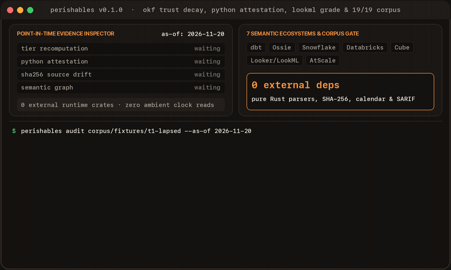
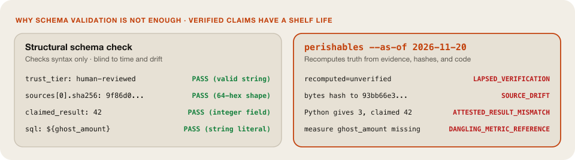
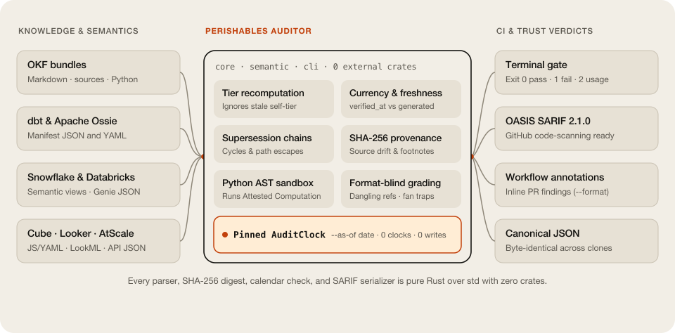

<p align="center">
  <a href="https://github.com/david-engelmann/perishables">
    <picture>
      <source media="(prefers-color-scheme: dark)" srcset="https://raw.githubusercontent.com/david-engelmann/perishables/main/docs/media/perishables-lockup-dark.svg">
      
    </picture>
  </a>
</p>

<h3 align="center">Point-in-time trust auditor for Open Knowledge Format bundles and seven analytics semantic layers, in zero-dependency Rust.</h3>

<p align="center">
  Verified claims have a shelf life. Schema validators check whether metadata fields parse. <code>perishables</code> checks whether those claims remain current, provenance-intact, acyclic, and computationally true at a pinned instant in time, with zero external crates in its dependency tree.
</p>

<p align="center">
  <a href="https://github.com/david-engelmann/perishables/blob/main/docs/README.md"><b>Docs</b></a> ·
  <a href="https://github.com/david-engelmann/perishables/blob/main/docs/ARCHITECTURE.md">Architecture</a> ·
  <a href="https://github.com/david-engelmann/perishables/blob/main/docs/DESIGN.md">OKF Trust Model</a> ·
  <a href="https://github.com/david-engelmann/perishables/blob/main/docs/CROSS-ECOSYSTEM.md">7 Semantic Layers</a> ·
  <a href="https://github.com/david-engelmann/perishables/blob/main/docs/CLAIMS.md">Claims &amp; Corpus</a> ·
  <a href="https://github.com/david-engelmann/perishables/releases">Releases</a>
</p>

<p align="center">
  <a href="https://github.com/david-engelmann/perishables/actions/workflows/ci.yml?query=branch%3Amain"></a>
  <a href="https://crates.io/crates/perishables"></a>
  <a href="https://pypi.org/project/perishables/"></a>
  <a href="https://docs.rs/perishables-core"></a>
  <a href="https://github.com/david-engelmann/perishables/blob/main/Cargo.lock"></a>
  <a href="https://github.com/david-engelmann/perishables/blob/main/LICENSE-MIT"></a>
</p>

<p align="center">
  
</p>

<p align="center"><sub>Every terminal line above comes from real executions of the <code>perishables</code> release binary against checked-in corpus fixtures and LookML models.</sub></p>

## Why perishables

Documentation bundles, AI context packs, and enterprise semantic layers rot quietly. A metric verified in June is regenerated in October while its frontmatter still reads `human-reviewed`. A raw CSV extract changes on disk while footnotes still cite the old numbers. A LookML measure references a deleted base field or introduces a duplicate business synonym. Schema validators pass every single one of those files because the syntax is still valid YAML, JSON, or LookML.

`perishables` evaluates whether trust claims still hold at an explicit `--as-of` instant.

- **Recomputed trust tiers.** Ignores stale self-reported tiers when underlying content was regenerated after its last verification (`LAPSED_VERIFICATION`), and flags `stable` concepts whose `stale_after` horizon has passed (`STALE_BUT_STABLE`).
- **Cryptographic provenance and supersession integrity.** Hashes bundled source files with in-tree FIPS 180-4 SHA-256 to catch silent byte drift (`SOURCE_DRIFT`), verifies every `[^id]` footnote and in-bundle path, and walks `superseded_by` graphs to convict cycles, missing targets, and root-escaping `../` paths.
- **Re-executed `Attested Computation` blocks.** Pre-screens deterministic Python blocks through `ast.parse`, binds typed parameters safely inside an isolated `0700` scratch folder with memory and timeout bounds, and compares the live result against the claimed figure (`ATTESTED_RESULT_MISMATCH`, `UNATTESTED_CLAIM`). Pass `--no-exec` when auditing untrusted bundles without subprocess execution.
- **Format-blind grading across seven semantic layers.** Hand-written JSON, YAML, JavaScript, and native LookML readers normalize definitions from **dbt**, **Apache Ossie**, **Snowflake**, **Databricks Genie**, **Cube**, **Looker / LookML**, and **AtScale** into one `Definition` graph, catching dangling references, name and synonym collisions, fan-trap joins, lapsed verified queries, and incomplete ground-truth benchmarks.
- **Zero external crates, zero ambient state, zero bundle writes.** `Cargo.lock` contains only the three workspace crates. No check reads `SystemTime::now()` or filesystem `mtime`, and `perishables corpus` hashes all 19 reference fixtures before and after auditing to prove zero directory mutation.

<p align="center">
  <picture>
    <source media="(prefers-color-scheme: dark)" srcset="https://raw.githubusercontent.com/david-engelmann/perishables/main/docs/media/shelf-life-proof-dark.svg">
    
  </picture>
</p>

## How it works

<p align="center">
  <picture>
    <source media="(prefers-color-scheme: dark)" srcset="https://raw.githubusercontent.com/david-engelmann/perishables/main/docs/media/how-it-works-dark.svg">
    
  </picture>
</p>

| Crate | Kind | External runtime deps | Role |
| --- | --- | --- | --- |
| [`perishables-core`](https://github.com/david-engelmann/perishables/blob/main/crates/perishables-core/README.md) | library | none (`std` only) | OKF bundle loader, YAML frontmatter and Markdown fence parser, proleptic Gregorian calendar math, FIPS 180-4 SHA-256, and the locked four-call trust surface. |
| [`perishables-semantic`](https://github.com/david-engelmann/perishables/blob/main/crates/perishables-semantic/README.md) | library | none (`std` only) | Hand-written JSON, YAML, JS, and native LookML readers plus format-blind semantic grading rules across seven analytics ecosystems. |
| [`perishables`](https://github.com/david-engelmann/perishables/blob/main/crates/perishables/README.md) | binary and library | none (`std` only) | CLI dispatcher (`audit`, `drift`, `corpus`, `grade`, `grade-*`), AST-screened Python sandbox executor, shell completion generator (`completions`), and `text`, `json`, `sarif`, and `github` formatters. |

## Quickstart

Install `perishables` from PyPI, from crates.io, with `cargo binstall perishables`, or via the SHA-256-verifying release installer (`install.sh`) across Linux and macOS.

```sh
pip install perishables
# or run directly without installing
uvx perishables --version
# or install prebuilt binaries verified against SHA256SUMS
curl -fsSL https://raw.githubusercontent.com/david-engelmann/perishables/main/install.sh | sh
# or install from crates.io
cargo install perishables
```

Generate shell tab-completion scripts for `bash`, `zsh`, `fish`, or `powershell` via the Python module CLI (`python -m perishables completions <shell>`) or embed [`perishables::completions`](https://docs.rs/perishables/latest/perishables/completions/index.html) in Rust:

```sh
python3 -m perishables completions bash > ~/.local/share/bash-completion/completions/perishables
python3 -m perishables completions zsh > ~/.zfunc/_perishables
python3 -m perishables completions fish > ~/.config/fish/completions/perishables.fish
```

The PyPI wheel bundles the native Rust `perishables` binary alongside a typed standard-library Python SDK.

```python
import perishables

report = perishables.audit("corpus/fixtures/clean-team-verified", as_of="2026-11-20")
report.raise_for_findings()

lookml = perishables.grade_looker(["orders.view.lookml", "sales.model.lookml"])
lookml.raise_for_findings()

sarif = perishables.audit_sarif(
    "corpus/fixtures/t1-lapsed",
    as_of="2026-11-20",
    output="audit.sarif",
)
```

### Audit an OKF knowledge bundle

Every `audit` run takes an explicit `--as-of` date or RFC 3339 timestamp so results stay reproducible forever across clones and machines.

```sh
perishables audit ./bundle --as-of 2026-11-20
perishables audit ./bundle --as-of 2026-11-20 --format sarif --output audit.sarif
perishables audit ./untrusted-bundle --as-of 2026-11-20 --no-exec
perishables drift ./bundle
perishables corpus
```

Exit code `0` means zero gate findings, `1` means one or more gate findings, and `2` means a command usage or input parse error.

### Grade semantic layers across seven ecosystems

Run ecosystem-specific subcommands or the unified `perishables grade` command with `--format text|json|sarif|github`.

```sh
perishables grade-dbt manifest.json
perishables grade-ossie model.yaml
perishables grade-snowflake view.yaml --changed-at 2026-11-20
perishables grade-databricks space.json
perishables grade-cube model.js
perishables grade-looker orders.view.lookml customers.view.lookml sales.model.lookml
perishables grade-atscale model.json
perishables grade model.yaml orders.view.lookml --format sarif --output semantic.sarif
```

### Finding codes at a glance

| Surface | Finding codes enforced |
| --- | --- |
| OKF bundle audit (`12` codes, `19` corpus fixtures) | `LAPSED_VERIFICATION`, `MALFORMED_VERIFICATION`, `SUPERSESSION_CYCLE`, `DANGLING_SUPERSEDED_BY`, `SUPERSEDED_WITHOUT_DEPRECATED`, `STALE_BUT_STABLE`, `UNPARSEABLE_STALE_AFTER`, `ATTESTED_RESULT_MISMATCH`, `UNATTESTED_CLAIM`, `UNRESOLVED_CITATION`, `MISSING_SOURCE`, `SOURCE_DRIFT` |
| Cross-ecosystem semantic grade (`6` rule codes + notes) | `DANGLING_METRIC_REFERENCE`, `NAME_COLLISION`, `LAPSED_VERIFIED_QUERY`, `DANGLING_RELATIONSHIP`, `BENCHMARK_WITHOUT_ANSWER`, `AMBIGUOUS_JOIN_PATH` |

### Embed in Rust or GitHub Actions

```rust
use perishables_core::{
    AuditClock, Bundle, check_currency, check_drift, check_freshness,
    check_provenance, check_supersession, recompute_tier,
};
use std::path::Path;

let clock = AuditClock::parse("2026-11-20").expect("valid date");
let bundle = Bundle::load(Path::new("corpus/fixtures/clean-healthy-chain"))
    .expect("bundle loads");

for concept in &bundle.concepts {
    let tier = recompute_tier(concept, &clock);
    println!("{} -> {}", tier.concept_id, tier.recomputed_tier.name());
}
assert!(check_currency(&bundle, &clock).is_empty());
assert!(check_supersession(&bundle).is_empty());
assert!(check_freshness(&bundle, &clock).is_empty());
assert!(check_provenance(&bundle).is_empty());
assert!(check_drift(&bundle).is_empty());
```

Configure the composite GitHub Action ([`action.yml`](https://github.com/david-engelmann/perishables/blob/main/action.yml)) in your workflow:

```yaml
- uses: david-engelmann/perishables@v0.1.2
  with:
    command: audit
    path: ./knowledge-bundle
    as-of: "2026-11-20"
    format: github
```

## Verification

Run the full zero-dependency gate locally across formatting, Clippy, unit and integration suites, the 19-fixture planted-defect corpus, rustdoc, and the library example.

```sh
cargo fmt --all -- --check
cargo clippy --workspace --all-targets --all-features --locked -- -D warnings
cargo test --workspace --all-features --locked
cargo run --locked -- corpus
RUSTDOCFLAGS="-D warnings" cargo doc --workspace --no-deps --locked
cargo run -p perishables-core --example audit_bundle --locked
```

## Documentation

| If you want to... | Read |
| --- | --- |
| Browse every specification and guide | [Documentation index](https://github.com/david-engelmann/perishables/blob/main/docs/README.md) |
| Understand crate boundaries and determinism guarantees | [Architecture](https://github.com/david-engelmann/perishables/blob/main/docs/ARCHITECTURE.md) · [Decisions](https://github.com/david-engelmann/perishables/blob/main/DECISIONS.md) |
| Read the OKF trust-tier, currency, and provenance specification | [OKF trust design](https://github.com/david-engelmann/perishables/blob/main/docs/DESIGN.md) · [Attested Computation](https://github.com/david-engelmann/perishables/blob/main/docs/ATTESTATION.md) |
| See how all seven analytics ecosystems map into one grading model | [Cross-ecosystem grading](https://github.com/david-engelmann/perishables/blob/main/docs/CROSS-ECOSYSTEM.md) · [Native LookML reader](https://github.com/david-engelmann/perishables/blob/main/docs/LOOKML.md) |
| Verify every claim against its corpus fixture or test | [Claims and corpus traceability](https://github.com/david-engelmann/perishables/blob/main/docs/CLAIMS.md) · [Reference corpus](https://github.com/david-engelmann/perishables/blob/main/corpus/README.md) |
| Review Python sandbox hardening, `--no-exec`, and release notes | [Security policy](https://github.com/david-engelmann/perishables/blob/main/SECURITY.md) · [Changelog](https://github.com/david-engelmann/perishables/blob/main/CHANGELOG.md) |

## Contributing

[CONTRIBUTING.md](https://github.com/david-engelmann/perishables/blob/main/CONTRIBUTING.md) details the zero-dependency rule, planted-defect fixture requirements, and local verification gates.

## License

Licensed under either of [MIT](https://github.com/david-engelmann/perishables/blob/main/LICENSE-MIT) or [Apache License, Version 2.0](https://github.com/david-engelmann/perishables/blob/main/LICENSE-APACHE) at your option.
