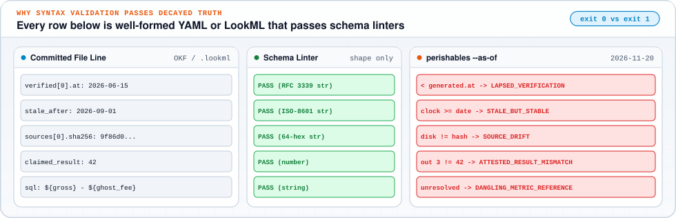
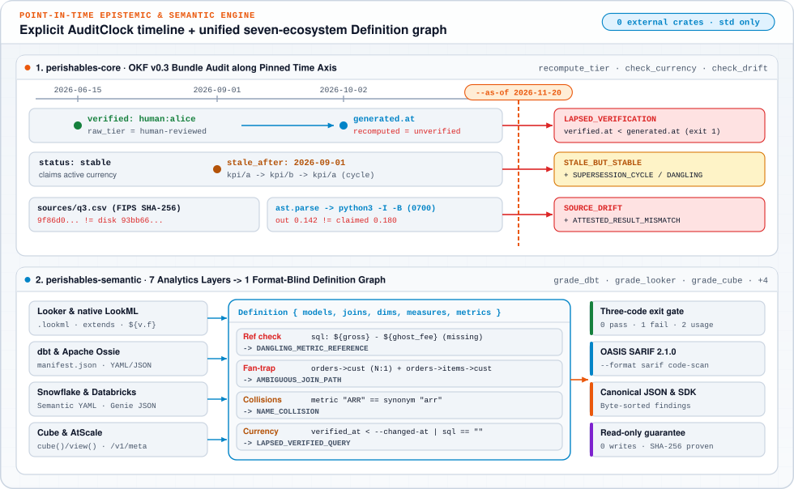

<div align="center">
  <picture>
    <source media="(prefers-color-scheme: dark)" srcset="https://raw.githubusercontent.com/david-engelmann/perishables/main/docs/media/perishables-lockup-dark.svg">
    
  </picture>
  <p><strong>Point-in-time trust auditor for Open Knowledge Format bundles and seven analytics semantic layers, written in pure Rust over <code>std</code> with zero external crates.</strong></p>
  <p>
    <a href="https://github.com/david-engelmann/perishables/actions/workflows/ci.yml"></a>
    <a href="https://crates.io/crates/perishables"></a>
    <a href="https://crates.io/crates/perishables-core"></a>
    <a href="https://crates.io/crates/perishables-semantic"></a>
    <a href="https://pypi.org/project/perishables/"></a>
    <a href="https://docs.rs/perishables-core"></a>
    <a href="https://github.com/david-engelmann/perishables/blob/main/LICENSE-MIT"></a>
  </p>
  <p>
    <a href="https://david-engelmann.github.io/perishables/">Documentation Book</a> ·
    <a href="https://github.com/david-engelmann/perishables/blob/main/docs/DESIGN.md">OKF Trust Model</a> ·
    <a href="https://github.com/david-engelmann/perishables/blob/main/docs/CROSS-ECOSYSTEM.md">7 Semantic Layers</a> ·
    <a href="https://github.com/david-engelmann/perishables/blob/main/docs/LOOKML.md">Native LookML</a> ·
    <a href="https://github.com/david-engelmann/perishables/blob/main/docs/CLAIMS.md">Claims &amp; Corpus</a> ·
    <a href="https://github.com/david-engelmann/perishables/tree/main/examples">Examples</a>
  </p>
</div>

<p align="center">
  
</p>

Verified documentation and BI metric definitions decay silently: a concept regenerated after its last human review keeps a stale `human-reviewed` label, a referenced CSV extract changes on disk, an attested Python figure stops matching its code block, or a LookML measure references a deleted field. Schema linters pass every one of those files because the YAML, JSON, or LookML syntax is still valid. `perishables` evaluates whether those claims hold at an explicit `--as-of` instant.

---

## Why Syntax Validation Passes Decayed Truth

<p align="center">
  <picture>
    <source media="(prefers-color-scheme: dark)" srcset="https://raw.githubusercontent.com/david-engelmann/perishables/main/docs/media/syntax-vs-truth-dark.svg">
    
  </picture>
</p>

Every planted-defect bundle in [`corpus/fixtures/`](https://github.com/david-engelmann/perishables/tree/main/corpus/fixtures) is well-formed Markdown and YAML. `perishables` never reads `SystemTime::now()` or filesystem `mtime` metadata: you pass `--as-of YYYY-MM-DD` (or `--changed-at` on semantic views), and the auditor computes a byte-identical verdict across `text`, `json`, OASIS `sarif` 2.1.0, and `github` workflow annotations without writing a single byte into the audited directory.

---

## Point-in-Time Bundle Audit & Seven-Ecosystem Semantic Graph

<p align="center">
  <picture>
    <source media="(prefers-color-scheme: dark)" srcset="https://raw.githubusercontent.com/david-engelmann/perishables/main/docs/media/audit-timeline-and-graph-dark.svg">
    
  </picture>
</p>

The workspace contains two pure-`std` analysis engines behind one CLI and Python SDK, with **zero third-party runtime or build dependencies** in `Cargo.lock`:

1. **OKF v0.3 epistemic bundle engine (`perishables-core` + `perishables` attestation runner):**
   - **Tier recomputation (`recompute_tier`):** Ignores self-reported tier labels and derives `unverified`, `machine-confirmed`, or `human-reviewed` strictly from well-formed verification events where `verified[].at >= generated.at`.
   - **Freshness & supersession graphs:** Checks `stale_after` against `AuditClock` using Howard Hinnant civil-day arithmetic, and walks multi-hop `superseded_by` links to convict cycles (>64 hops or revisited nodes), bundle-root `../` escapes, external URIs, and non-deprecated supersessions.
   - **Provenance & sandboxed `Attested Computation`:** Matches Markdown `[^id]` citations outside code spans to `sources`, hashes in-bundle files with in-tree FIPS 180-4 SHA-256 (`SOURCE_DRIFT`), and pre-screens deterministic Python blocks via `ast.parse` before running `python3 -I -B` inside an isolated `0700` scratch directory (or skips all subprocesses under `--no-exec`).
2. **Cross-ecosystem semantic-layer engine (`perishables-semantic`):**
   - Hand-written zero-dependency parsers normalize **dbt** (`manifest.json`, `semantic_manifest.json`), **Apache Ossie** (YAML/JSON), **Snowflake** (Semantic View YAML), **Databricks Genie** (`serialized_space` JSON), **Cube** (`.js` `cube()`/`view()`, `.yaml`, `/v1/meta` JSON), **Looker / native LookML** (`.view.lookml`, `.model.lookml` with `extends` inheritance and `include` globs, plus API JSON), and **AtScale** (model JSON) into a single `Definition` graph.
   - Runs six format-blind graph rules over `Definition` to convict broken `${view.field}` / metric references, case-insensitive display-name and synonym collisions, lapsed verified queries, missing join or `extends` targets, empty benchmark answers, and multi-grain join fan-traps.

---

## Quickstart: CLI, Python SDK, and SARIF 2.1.0 CI Gate

```sh
# Python wheel (bundles native perishables binary + typed Python SDK)
pip install perishables

# Prebuilt Linux / macOS tarball verified against SHA256SUMS
curl -fsSL https://raw.githubusercontent.com/david-engelmann/perishables/main/install.sh | sh

# Build from source via crates.io (0 external crates to download)
cargo install perishables
```

### Audit bundles and grade semantic layers from the CLI

```sh
# Audit an OKF bundle at a pinned date (pass --no-exec on untrusted inputs)
perishables audit ./knowledge-bundle --as-of 2026-11-20 --format json
perishables audit ./untrusted-bundle --as-of 2026-11-20 --no-exec --format json
perishables drift ./knowledge-bundle --format json

# Grade LookML, dbt, Snowflake, Databricks, Cube, Ossie, or AtScale offline
perishables grade-looker views/orders.view.lookml models/sales.model.lookml
perishables grade-dbt target/manifest.json
perishables grade model.yaml views/orders.view.lookml --format sarif --output semantic.sarif

# Run the built-in 19-fixture self-verification gate
perishables corpus --format json
```

| Exit code | Meaning | Typical action |
| --- | --- | --- |
| `0` | Clean pass | Zero trust or semantic findings (informational `Note` coverage items never fail the gate). |
| `1` | Gate failure | One or more deterministic `FindingCode` items emitted in stdout `text`, `json`, `sarif`, or `github`. |
| `2` | Usage, I/O, or syntax error | Invalid CLI flags, missing input path, or malformed YAML / JSON / LookML / JS syntax on stderr. |

### Drive from Python (`perishables`) or GitHub Actions

```python
import perishables

audit = perishables.audit("corpus/fixtures/clean-team-verified", as_of="2026-11-20", no_exec=True)
audit.raise_for_findings()

lookml = perishables.grade_looker(["orders.view.lookml", "sales.model.lookml"])
sarif_doc = perishables.grade_sarif(["orders.view.lookml"], ecosystem="looker")
```

```yaml
- uses: david-engelmann/perishables@v0.1.3
  with:
    command: grade-looker
    path: "views/orders.view.lookml models/sales.model.lookml"
    format: github
```

---

## Complete Finding Taxonomy (18 Deterministic Codes)

All finding codes are closed under semantic versioning and mapped 1-to-1 to fixtures in [`docs/CLAIMS.md`](https://github.com/david-engelmann/perishables/blob/main/docs/CLAIMS.md):

### OKF Bundle Findings (`perishables-core` & `perishables`)

| Code | Trigger condition |
| --- | --- |
| `LAPSED_VERIFICATION` | A verification event timestamp `at` predates `generated.at` on the same concept. |
| `MALFORMED_VERIFICATION` | A verification entry is missing `by` or carries an unparseable `at` timestamp. |
| `STALE_BUT_STABLE` | `AuditClock >= stale_after` while the concept still declares (or defaults to) `status: stable`. |
| `UNPARSEABLE_STALE_AFTER` | `stale_after` contains an invalid calendar date or malformed timestamp (never treated as fresh). |
| `SUPERSESSION_CYCLE` | Walking `superseded_by` revisits a concept or exceeds 64 hops. |
| `DANGLING_SUPERSEDED_BY` | `superseded_by` points to a missing concept, an external URI, or a `../` path escaping the bundle root. |
| `SUPERSEDED_WITHOUT_DEPRECATED` | Concept carries `superseded_by` while `status` is not `deprecated`. |
| `UNRESOLVED_CITATION` | Markdown body footnote `[^label]` outside code blocks matches no `sources[].id`. |
| `MISSING_SOURCE` | In-bundle `sources[].resource` file is absent from the bundle inventory or escapes the root. |
| `SOURCE_DRIFT` | On-disk FIPS 180-4 SHA-256 digest of a bundled source file differs from recorded `sources[].sha256`. |
| `ATTESTED_RESULT_MISMATCH` | Sandboxed Python `Attested Computation` output differs from `claimed_result`. |
| `UNATTESTED_CLAIM` | Concept claims an attested result under an unsupported runtime or while `--no-exec` is active. |

### Cross-Ecosystem Semantic Findings (`perishables-semantic`)

| Code | Trigger condition |
| --- | --- |
| `DANGLING_METRIC_REFERENCE` | Metric, LookML `${field}` / `${view.field}`, Cube `view`, or AtScale hierarchy references an undefined target. |
| `NAME_COLLISION` | Two or more metrics, measures, dimensions, or `synonyms` claim the same case-folded display name. |
| `LAPSED_VERIFIED_QUERY` | Stored `verified_at` timestamp on a verified query predates `--changed-at`. |
| `DANGLING_RELATIONSHIP` | Join, relationship, or LookML `extends` parent names a missing model, view, table, or cube. |
| `BENCHMARK_WITHOUT_ANSWER` | Ground-truth benchmark or verified query has an empty natural-language question or empty expected SQL. |
| `AMBIGUOUS_JOIN_PATH` | Two models connect both directly and via a 2- or 3-edge alternate join route at a different grain (fan-trap). |

---

## Zero-Dependency Workspace & Specifications

| Crate | External crates | Scope |
| --- | --- | --- |
| [`perishables-core`](https://github.com/david-engelmann/perishables/blob/main/crates/perishables-core/README.md) | `0` (`std` only) | OKF v0.3 parser, civil-day calendar math, FIPS 180-4 SHA-256, `recompute_tier`, currency, supersession, and drift checks. |
| [`perishables-semantic`](https://github.com/david-engelmann/perishables/blob/main/crates/perishables-semantic/README.md) | `0` (`std` only) | Native JSON, YAML, JS `cube()`/`view()`, and LookML lexers/parsers plus format-blind `Definition` grading. |
| [`perishables`](https://github.com/david-engelmann/perishables/blob/main/crates/perishables/README.md) | `0` (`std` only) | CLI binary, AST-screened Python attestation runner, canonical JSON & OASIS SARIF 2.1.0 renderers, corpus gate, and shell completions. |

- **Specifications:** [Published Documentation Book](https://david-engelmann.github.io/perishables/) · [`docs/ARCHITECTURE.md`](https://github.com/david-engelmann/perishables/blob/main/docs/ARCHITECTURE.md) · [`docs/DESIGN.md`](https://github.com/david-engelmann/perishables/blob/main/docs/DESIGN.md) · [`docs/ATTESTATION.md`](https://github.com/david-engelmann/perishables/blob/main/docs/ATTESTATION.md) · [`docs/CROSS-ECOSYSTEM.md`](https://github.com/david-engelmann/perishables/blob/main/docs/CROSS-ECOSYSTEM.md) · [`docs/LOOKML.md`](https://github.com/david-engelmann/perishables/blob/main/docs/LOOKML.md) · [`docs/CLAIMS.md`](https://github.com/david-engelmann/perishables/blob/main/docs/CLAIMS.md)
- **Guides & Policies:** [`docs/COMPARISON.md`](https://github.com/david-engelmann/perishables/blob/main/docs/COMPARISON.md) · [`docs/FAQ.md`](https://github.com/david-engelmann/perishables/blob/main/docs/FAQ.md) · [`examples/`](https://github.com/david-engelmann/perishables/tree/main/examples) · [`fuzz/`](https://github.com/david-engelmann/perishables/tree/main/fuzz) · [`AGENTS.md`](https://github.com/david-engelmann/perishables/blob/main/AGENTS.md) · [`SECURITY.md`](https://github.com/david-engelmann/perishables/blob/main/SECURITY.md)

## License

Licensed under either of [Apache License, Version 2.0](https://github.com/david-engelmann/perishables/blob/main/LICENSE-APACHE) or [MIT License](https://github.com/david-engelmann/perishables/blob/main/LICENSE-MIT), at your option.
