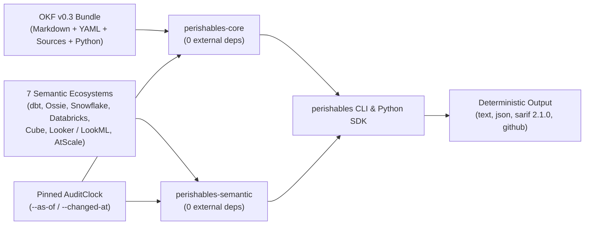

# Introduction

  
  

**`perishables`** is a deterministic, point-in-time trust auditor for [Open Knowledge Format (OKF)](docs/DESIGN.md) bundles and [seven analytics semantic layers](docs/CROSS-ECOSYSTEM.md), implemented in safe Rust with **zero external runtime or build crates**.

Verified claims have a shelf life. Schema validators check whether YAML, JSON, or LookML parses structurally. `perishables` checks whether those claims remain current, provenance-intact, acyclic, unambiguous, and computationally true at an explicit `--as-of` instant.

  

## What perishables checks

- **Recomputed trust tiers and currency (`perishables-core`).** Derives `unverified`, `machine-confirmed`, or `human-reviewed` strictly from verification events that postdate `generated.at`, catching silent tier inflation (`LAPSED_VERIFICATION`), malformed events (`MALFORMED_VERIFICATION`), and expired stability horizons (`STALE_BUT_STABLE`).
- **Cryptographic provenance and supersession graphs (`perishables-core`).** Hashes referenced bundle files with in-tree FIPS 180-4 SHA-256 (`SOURCE_DRIFT`), validates `[^id]` footnote citations and in-bundle paths (`UNRESOLVED_CITATION`, `MISSING_SOURCE`), and walks `superseded_by` chains (`SUPERSESSION_CYCLE`, `DANGLING_SUPERSEDED_BY`, `SUPERSEDED_WITHOUT_DEPRECATED`).
- **AST-screened `Attested Computation` re-execution (`perishables`).** Pre-screens deterministic Python blocks with `ast.parse`, binds typed parameters in an isolated `0700` scratch directory, and compares the live result against the claimed figure (`ATTESTED_RESULT_MISMATCH`, `UNATTESTED_CLAIM`), with `--no-exec` for zero-subprocess untrusted bundle audits.
- **Format-blind semantic-layer grading (`perishables-semantic`).** Normalizes **dbt**, **Apache Ossie**, **Snowflake**, **Databricks Genie**, **Cube**, **Looker / native LookML**, and **AtScale** definitions into a single `Definition` graph and convicts dangling references, display-name and synonym collisions, lapsed verified queries, dangling relationships, empty ground-truth benchmarks, and join-path fan traps.

  
  

## Where to go next

| Goal | Chapter |
| --- | --- |
| Install `perishables` and run your first bundle audit or semantic grade | [Quickstart](./quickstart.md) |
| Integrate the CLI, SARIF 2.1.0 output, or typed Python SDK into CI or an agent | [CLI and Python SDK Reference](./cli-and-python.md) |
| Understand the 12 OKF finding codes and Python attestation sandbox | [OKF Trust Model](docs/DESIGN.md) and [Attested Computation](docs/ATTESTATION.md) |
| Grade dbt, Ossie, Snowflake, Databricks, Cube, LookML, and AtScale models | [Seven-Ecosystem Grading Model](docs/CROSS-ECOSYSTEM.md) and [Native LookML Reader](docs/LOOKML.md) |
| See how `perishables` relates to schema linters, `dbt parse`, `spectacles`, and monitors | [How perishables Compares](docs/COMPARISON.md) and [FAQ](docs/FAQ.md) |
| Inspect runnable Python and POSIX shell gate scripts | [Runnable examples on GitHub](https://github.com/david-engelmann/perishables/tree/main/examples) |
